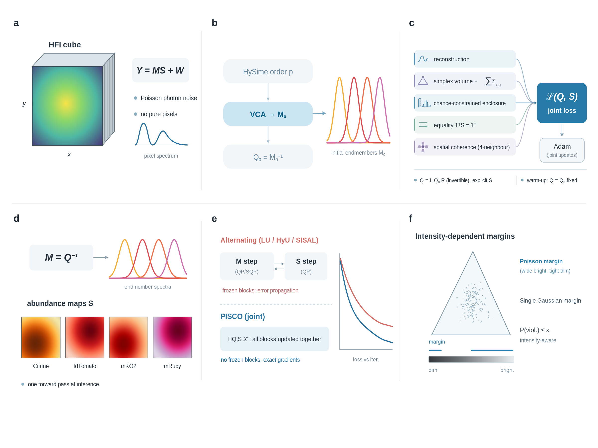

# PISCO: Poisson integrated spatially coherent unmixing for photon-limited hyperspectral fluorescence imaging
Jun Li, Yanlong Guo, Zhaozhao Zeng, Zhonghui Tang

**Overview of PISCO for blind unmixing of large-field hyperspectral fluorescence data.** **a,** An HFI data cube (spatial dimensions $x, y$; 32 spectral channels) is acquired from a multiply labelled specimen; each pixel spectrum is a linear mixture $Y = MS + W$ of unknown endmember spectra. **b,** Preprocessing: the endmember number $p$ is estimated by HySime; the data are projected onto the $(p - 1)$-dimensional signal subspace and spherized; VCA provides the initial endmember estimate $M_0$ with $Q_0 = M_0^{-1}$. **c,** Joint optimization of the unmixing operator and abundances. The operator is parameterized as an invertible coupling $Q = LQ_0R$ ($L$ unit lower-triangular; $R$ upper-triangular with exponentially parameterized diagonal $r_{\log}$, the vector of log-diagonal entries), making the simplex volume $-\log |\det Q| = -\sum r_{\log}$ differentiable. Abundances are explicit per-pixel variables optimized jointly with the coupling under differentiable simplex penalties. The objective combines the reconstruction fidelity, simplex-volume, chance-constrained data-enclosure, equality-constraint and spatial-coherence (four-neighbour Laplacian) terms; all terms are optimized end to end by Adam after a warm-up phase with $Q$ fixed at $Q_0$. **d,** Outputs: blindly extracted endmember spectra $M = Q^{-1}$ (including endmembers absent from spectral libraries, such as autofluorescence) and spatially coherent abundance maps. **e,** Schematic contrast of solver strategies: alternating QP/SQP schemes update each variable block while the others are frozen, so estimation errors propagate between blocks, whereas PISCO optimizes all variables jointly within one differentiable objective. **f,** The Poisson chance constraint yields intensity-dependent enclosure margins — wide for bright pixels, tight for dim ones — replacing the single intensity-independent Gaussian margin of classical robust solvers.

# Abstract
Hyperspectral fluorescence imaging collects a full emission spectrum at every pixel of a sample, but because several fluorescent components commonly overlap in space, the spectrum recorded at each pixel is a mixture of the contributing signals; resolving these mixtures into quantitative maps of the individual components is the task of spectral unmixing. Methods in routine use require a measured reference spectrum for every component — unavailable for unanticipated signals such as tissue autofluorescence — whereas existing blind methods, which estimate spectra and abundances jointly, treat pixels independently and assume intensity-independent noise, mis-calibrating precisely the low-photon regime in which live imaging operates. We present PISCO (Poisson integrated spatially coherent unmixing), a blind unmixing model built around the statistics of photon counting — registered photon counts are intrinsically Poisson distributed, so the noise grows with the signal itself — in which a Poisson-derived chance-constraint criterion identifies the constituent spectra under the true count statistics, a spatial-coherence term exploits the similarity of neighbouring pixels, and the entire model is trained end to end on a single image as a single differentiable objective. Across biologically calibrated simulations, public fluorescence hyperspectral benchmarks and in vivo zebrafish images, PISCO demonstrated spectral unmixing under photon-limited and large-field conditions. It extracted five and eight endmembers from the single-photon and two-photon zebrafish fields, respectively, and resolved an additional autofluorescence-associated component in a five-label cell benchmark. In simulations, PISCO matched or outperformed the evaluated baselines at photon budgets down to 2 mean photons per channel and maintained accuracy across fields of 10⁴ to 4 × 10⁶ pixels. By matching the unmixing criterion to the physics of photon counting, PISCO extends multiplexed fluorescence imaging to photon budgets and field sizes that were previously inaccessible.

